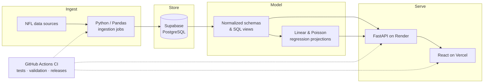
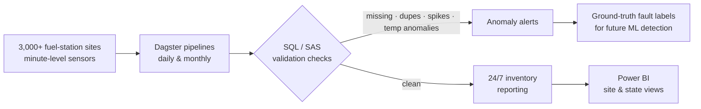

<div align="center">


[](https://www.linkedin.com/in/patrick-mejia-6045151a1)
[](mailto:pmejia1010@gmail.com)
[](https://www.pemsports.com)


</div>

---

### `$ cat profile.yaml`

```yaml
engineer:
  name: Patrick Mejia
  role: Data Engineer / Analyst @ Warren Rogers
  location: Boston, MA
  languages: [English, Spanish]

focus:
  - cloud-native data platforms
  - ETL/ELT pipelines & orchestration
  - data quality, testing & governance
  - turning raw telemetry into decisions

education:
  - { school: WPI, degree: M.S. Computer Science, status: in_progress, expected: 2027 }
  - { school: WPI, degree: B.S. Computer Science, year: 2023, honors: Distinction }

certifications:
  - Astronomer DAG Authoring
  - Astronomer Airflow Fundamentals

currently_shipping: pemsports.com
sla: reply within 24h  # say hi 👋
```

---

### `SELECT * FROM career ORDER BY start_date DESC;`

| company | role | stack | impact |
|---|---|---|---|
| **Warren Rogers** | Data Engineer / Analyst | Dagster · SQL · SAS · Power BI | Ingests **millions** of minute-level sensor readings/day from **3,000+** sites for 24/7 inventory reporting |
| **PEM Sports** | Founder & Lead Engineer | React · FastAPI · Supabase · GitHub Actions | Live NFL analytics platform; ingestion automation cut manual effort **>90%** |
| **Iron Mountain** | Data Platform Engineer | GCP · BigQuery · Airflow · Terraform · Jenkins | Self-service data onboarding platform adopted by **30+** teams; **+20%** pipeline automation |
| **Laronde** | Software Engineer Intern | Python · BioPython · BigQuery | Parsed **2,000+** GenBank files into a queryable genomic database |
| **Advanced Instruments** | Engineering Intern | Python · PyQt · SQL | Redesigned an osmometer UI; built a compliance-tracking database |

<sub>`5 rows returned` · `query time: 2019 → present`</sub>

---

### 🏈 Featured: [PEM Sports](https://www.pemsports.com) architecture

A production NFL analytics platform I designed, built, and operate end to end. It covers 800+ players, teams, seasons, and matchups.



---

### 🛰️ What I build at work: sensor telemetry at scale



---

### 🧱 Stack by pipeline layer

| Layer | Tools |
|---|---|
| **Ingest** |     |
| **Orchestrate** |   |
| **Transform** |     |
| **Store** |      |
| **Quality & Governance** |    |
| **Infra & CI/CD** |     |
| **Serve & Visualize** |     |

---

### 📈 Observability (aka my GitHub metrics)

<div align="center">
  
  
</div>

---

<div align="center">

```text
[pipeline] status=healthy · last_run=today · next_run=tomorrow 06:00 · open_to=collaboration
```

</div>
